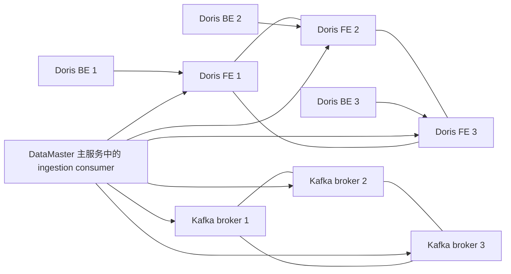

# Ingestion 集群独立部署

这里是 ingestion 基础设施的独立部署目录，不会被主部署脚本 `deploy/start-all.sh` 自动执行，也不会把 Kafka、Doris 加入主系统的默认部署组。

架构如下：



## 配置

编辑 [deploy.yml](deploy.yml)：

- `kafka_nodes`：Kafka 三节点，格式为 `nodeId@可访问IP`；
- `doris_fe_nodes`：Doris FE 三节点；
- `doris_be_nodes`：Doris BE 三节点；
- `kafka_topics`：需要自动创建的 topic，多个 topic 用逗号分隔；
- 镜像名和离线 tar 包名可按现场版本调整。

脚本使用 Docker host network，因此节点 IP 必须是集群节点之间可互通、且 DataMaster 主服务可访问的地址。默认端口为：

| 组件 | 端口 |
|---|---:|
| Kafka broker | 9092 |
| Kafka controller | 9093 |
| Doris FE HTTP | 8030 |
| Doris FE MySQL | 9030 |
| Doris FE edit log | 9010 |
| Doris BE HTTP | 8040 |
| Doris BE heartbeat | 9050 |
| Doris BE BRPC | 8060 |

每个 Kafka、FE、BE 节点至少需要一台 Linux Docker 主机。Doris 节点启动前脚本会设置 `vm.max_map_count=2000000`。

## 一键部署

只部署 ingestion 集群：

```bash
./deploy/ingestion/deploy.sh
```

本地检查，不连接远程主机：

```bash
./deploy/ingestion/deploy.sh --check
```

也可以使用别名：

```bash
./deploy/ingestion/start-all.sh
```

离线部署时，把 Kafka、Doris FE、Doris BE 镜像 tar 放到 `deploy/packages/components/`，文件名与 `deploy/ingestion/deploy.yml` 一致。tar 不存在时脚本会跳过 `docker load`，直接使用目标机器已有镜像。

## 启停和状态

```bash
# 启动全部 ingestion 集群
./deploy/ingestion/start all

# 停止全部 ingestion 集群
./deploy/ingestion/stop all

# 重启全部 ingestion 集群
./deploy/ingestion/restart all

# 查看容器状态
./deploy/ingestion/status all
```

也可以单独操作：

```bash
./deploy/ingestion/start kafka
./deploy/ingestion/start doris
./deploy/ingestion/stop kafka
./deploy/ingestion/status doris-fe
./deploy/ingestion/status doris-be
```

部署后脚本会生成 `deploy/ingestion/.runtime/endpoints.env`，其中包含 Kafka bootstrap 地址和 Doris FE 查询地址。

## 与 DataMaster 主服务的衔接

Kafka、Doris 的容器由本目录管理；DataMaster Java 主服务仍由主部署目录管理。主服务配置中的：

- `datamaster.ingestion.kafka.bootstrap-servers` 应填写 `KAFKA_BOOTSTRAP_SERVERS`；
- `datamaster.ingestion.kafka.topics` 应填写已创建的 topic；
- `datamaster.ingestion.doris-datasource-id` 必须填写 DataMaster 数据源管理中注册的 Doris 数据源 ID；
- `datamaster.ingestion.enabled` 在 Kafka、Doris 和数据源配置完成后再改为 `true`。

启用前请确认 topic 消息包含 `key-columns` 对应的主键值；CDC 删除可使用 `__op`/`__operation`/`__eventType=DELETE`。消费日志会按 `topic + partition + offset` 记录成功事件，重复投递会跳过已成功落库消息。默认失败消息最多重试 3 次，可通过 `ingestion_kafka_max_retries`、`ingestion_kafka_retry_backoff_ms` 调整；重试次数会持久化到 `INGESTION_EVENT`，服务重启后不会从零开始计算。事件租约默认 5 分钟，并每 60 秒续租，可通过 `ingestion_kafka_event_lease_ms`、`ingestion_kafka_lease_renew_interval_ms` 调整。配置 `ingestion_kafka_dead_letter_topic` 后，超过次数的消息会转入死信 topic，否则仍会阻塞当前分区等待人工处理。

消息校验支持 `ingestion_allowed_tables`（动态目标表白名单）、`ingestion_required_columns`（非 DELETE 消息必填字段）和 `ingestion_schema_version`（要求消息携带匹配的 `__schemaVersion`）。目标表和业务字段名只允许安全标识符格式，避免消息中的动态表名或字段名直接形成非法 SQL。

死信接口支持筛选和批量重放：`GET /ingestion/dead-letters?limit=50&topic=xxx&targetTable=customer` 可按 topic/目标表查询；`POST /ingestion/dead-letters/replay` 请求体为 `{\"logId\":123}`，批量接口 `POST /ingestion/dead-letters/replay-batch` 请求体为 `{\"logIds\":[123,124]}`，单次最多 100 条。原始 Kafka key 会保存并在重放时恢复，重放过程会先原子标记为 `REPLAYING`；服务中断超过 10 分钟的处理中记录可被再次领取。

运行监控接口：`GET /ingestion/metrics` 返回 `INGESTION_LOG` 和 `INGESTION_EVENT` 按状态汇总的数量，可用于接入监控系统；`GET /ingestion/runtime` 返回 Kafka 消费者实际状态、最近轮询时间、成功/失败计数以及每 30 秒采样的总积压/分区积压。维护窗口可调用 `POST /ingestion/pause` 优雅暂停，再调用 `POST /ingestion/resume` 恢复；暂停期间仍会 poll 以维持 Kafka 消费组心跳，并会先处理完已经拉取的批次。配置了相同 `triggerRef` 的已发布且启用 Workflow 也会由受信任数据到达事件自动异步入队，并按 `eventId + workflow` 幂等。`GET /ingestion/config` 返回脱敏配置摘要，不会返回动作触发 secret。

首次启用 ingestion 前，请先对 DataMaster PostgreSQL 执行 [`sql/update_20261012_ingestion_reliability.sql`](../../sql/update_20261012_ingestion_reliability.sql)，确保 `INGESTION_LOG`、`INGESTION_EVENT` 表、幂等索引以及 `ONT_ACTION_EXECUTION.DATASOURCE_ID` 存在。后者用于人工编辑仲裁按数据源隔离同名表。`INGESTION_EVENT` 使用租约防止多个 DataMaster 实例同时处理同一事件。该迁移使用 `IF NOT EXISTS`，可重复执行。

管理接口需要为账号授予 `ingestion:query`（配置、运行态、指标、死信查询）、`ingestion:replay`（单条/批量死信重放）和 `ingestion:control`（暂停/恢复消费）权限；重放和启停接口都会写入系统操作审计日志。

死信处理接口：`GET /ingestion/dead-letters?limit=50` 查询，`POST /ingestion/dead-letters/replay` 携带 `{"logId": <死信日志ID>}` 单条重放，或使用 `POST /ingestion/dead-letters/replay-batch` 批量重放。重放会先原子标记 `REPLAYING`，成功后原记录状态为 `REPLAYED`，消息会以新 offset 重新消费。

脚本不会自动向 DataMaster 业务库写入 Doris 数据源记录，也不会重启主服务。这样可以单独扩缩或维护 ingestion 集群，不影响主系统其他模块。
